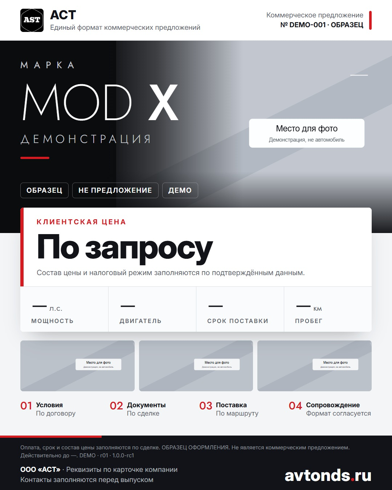

# Единый формат коммерческих предложений АСТ

**Один промпт, одни шаблоны, одна версия для сотрудников и ИИ.**

Версия **1.0.0-rc3** от 27.10.2026. Это подготовленный общий пакет для согласования и применения по прямому запросу; существующие проекты и серверы автоматически не переключены.

## С чего начать

1. Откройте [PROMPT.md](PROMPT.md) и скопируйте промпт в свой ИИ-чат.
2. Добавьте ссылку на объявление либо исходные данные, фото и клиентскую цену. Для импорта фото из публичной ссылки используйте `fetch_listing_photos.py`; порядок — в [PHOTO_IMPORT.md](PHOTO_IMPORT.md).
3. Получите A4 и карточку 1080×1350, проверьте факты и оформление. Отправка клиенту — отдельное действие с соответствующими полномочиями.

Если ИИ не может прочитать GitHub, приложите `PROMPT.md`, `STANDARD.md`, оба HTML-шаблона и папку `assets/`. Один текст промпта не заменяет шаблоны и не гарантирует точное оформление.

## Что внутри

| Файл | Назначение |
|---|---|
| [PROMPT.md](PROMPT.md) | Полная инструкция для чата или исполнителя |
| [STANDARD.md](STANDARD.md) | Правила оформления, данных и приёмки |
| [templates/a4.html](templates/a4.html) | Основное КП на одну страницу A4 |
| [templates/social.html](templates/social.html) | Карточка 1080×1350 |
| [data/quote.example.json](data/quote.example.json) | Демонстрационная структура клиентских данных |
| [examples/a4.jpg](examples/a4.jpg) | Проверенный пример A4 без реального предложения |
| [examples/social.jpg](examples/social.jpg) | Проверенный пример карточки |
| [MANIFEST.json](MANIFEST.json) | Версия и контрольные суммы пакета |
| [PHOTO_IMPORT.md](PHOTO_IMPORT.md) | Импорт фотографий из публичного объявления |
| [fetch_listing_photos.py](fetch_listing_photos.py) | Утилита загрузки локальных копий фотографий |

## Как пользоваться в разных проектах

В инструкции проекта укажите: «Для автомобильных КП АСТ применять пакет `ast-kp-standard` версии `1.0.0-rc3`, читать `PROMPT.md` и `STANDARD.md`, создавать документы из `templates/`, фиксировать версию в результате».

Для автоматизации закрепляйте конкретный commit и контрольные суммы; не скачивайте изменяемую ветку перед каждым заданием без проверки. В облачном чате отдельно проверьте, что файлы действительно прочитаны. Ссылка сама по себе не устанавливает стандарт в другой чат, навык или сервер.

## Что не включено

Здесь нет клиентских заявок, закупочных цен, маржи, продавцов, ссылок на объявления, частных чатов, локальных путей, ключей или настроек действующих сервисов. Демонстрационные данные и изображения не описывают реальный автомобиль. Расчёт налогов, себестоимости и курса выполняет отдельная проверенная методика сделки.

Шрифты включены локально с лицензиями: [Inter](assets/fonts/Inter-OFL.txt), [Jost](assets/fonts/Jost-OFL.txt). Во время отображения шаблон не загружает внешние шрифты или скрипты.

## Импорт фотографий из объявления

Если предоставлена только ссылка, импортёр открывает публичную страницу в Chromium и сохраняет найденные изображения и `photos.json` с источниками и SHA-256. Перед КП фотографии нужно проверить вручную: автоматическая загрузка не подтверждает, что это именно нужный автомобиль. При CAPTCHA, авторизации, блокировке или отсутствии фото площадка не обходится — фотографии прикладываются вручную.

## Изменение стандарта

Изменение стиля или обязательных полей создаёт новую версию. Старые КП сохраняют прежнюю редакцию. Принятие стандарта, установка в проект и проверенный выпуск учитываются отдельно. Обновление правил не даёт разрешения на сообщения, публикацию, CRM, расходы или запуск служб.
